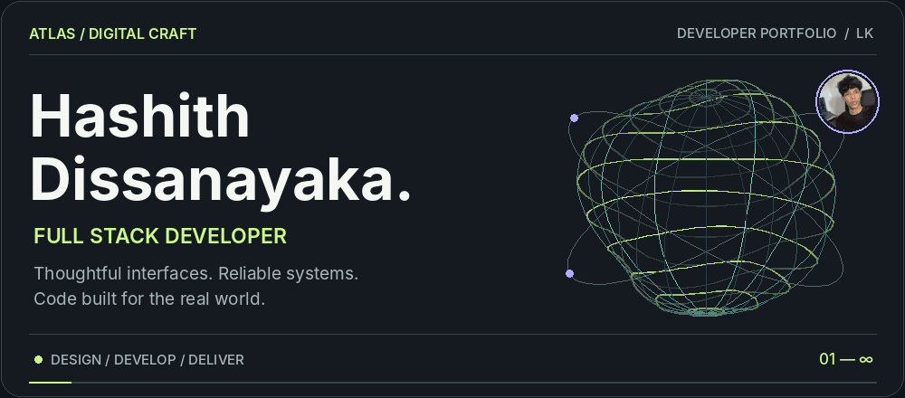
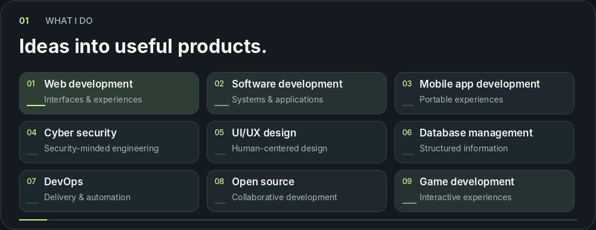
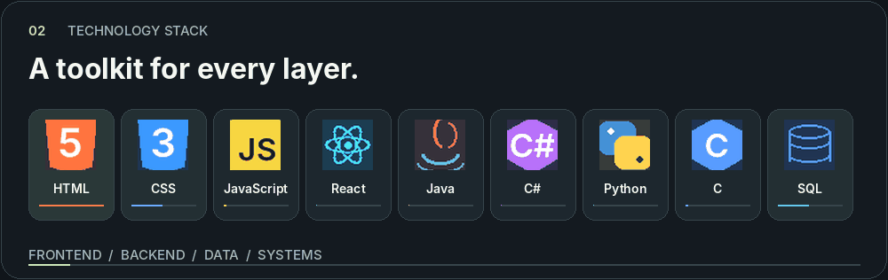
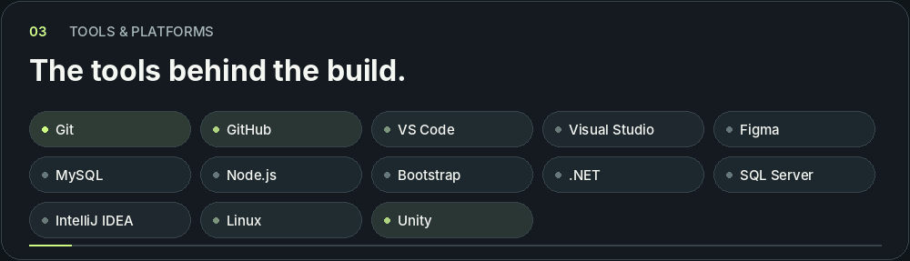
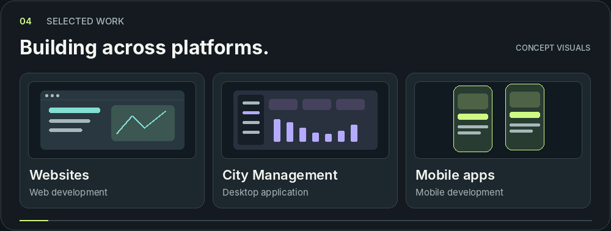
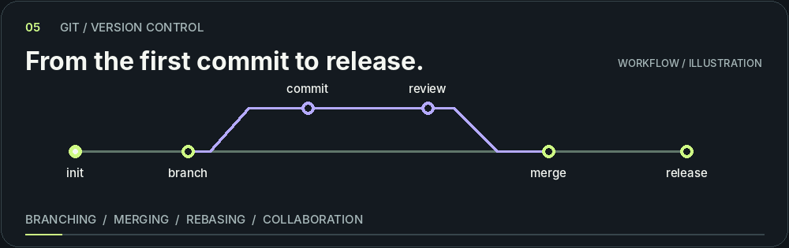
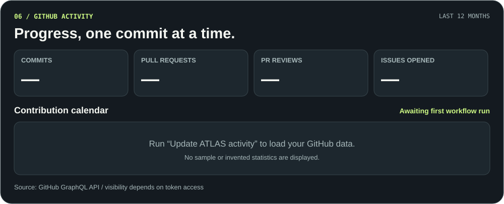
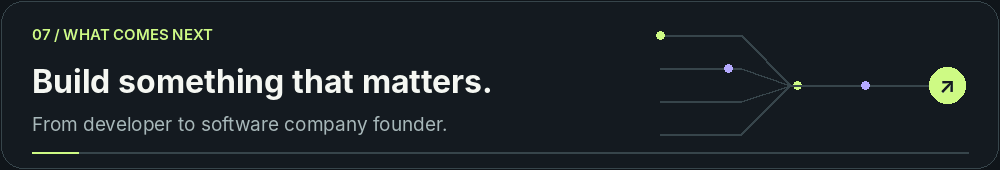

<!-- ATLAS · Personal developer portfolio — editable README, separate local motion assets. -->

# Hi, I'm Hashith Dissanayaka.

**Full Stack Developer · Sri Lanka**

I enjoy building digital products that bring clean design, reliable code and practical functionality together. My work spans modern websites, desktop applications and mobile apps. I am interested in the complete development lifecycle — from an idea and its interface to databases, version control and delivery.

[Explore my repositories ↗](https://github.com/Hashith-Dissanayaka?tab=repositories) · [Get in touch ↗](mailto:hashithdissanayaka@gmail.com)

## What I do & explore

I value intuitive user experiences, maintainable software and learning how technologies work together to solve real-world problems.

## My technology stack

**Frontend** — HTML, CSS, JavaScript, React, Bootstrap  
**Programming & backend** — Java, C#, Python, C, Node.js, .NET  
**Data** — SQL, MySQL, SQL Server

## Tools & platforms

## Selected work

**Websites** — Modern web development and responsive interfaces.  
**City Management System** — A desktop application for city-related management workflows.  
**Mobile apps** — Practical applications for mobile devices.

[Browse my projects ↗](https://github.com/Hashith-Dissanayaka?tab=repositories)

## Git & engineering workflow

Git is one of my core technical strengths. I value clear version history, organized commits, structured branching and collaborative development. The animated flow is an illustration, not my live commit history or a proficiency score.

## GitHub progress

Updated daily by GitHub Actions after setup. Counts reflect the contributions accessible to the workflow token. Private activity may not be included.

[View my contribution history ↗](https://github.com/Hashith-Dissanayaka#contribution-activity)

## My vision

My long-term goal is to build my own software development company and create meaningful digital products that solve real problems.

**Let's connect.** [hashithdissanayaka@gmail.com](mailto:hashithdissanayaka@gmail.com)

[GitHub ↗](https://github.com/Hashith-Dissanayaka) · [Repositories ↗](https://github.com/Hashith-Dissanayaka?tab=repositories)
