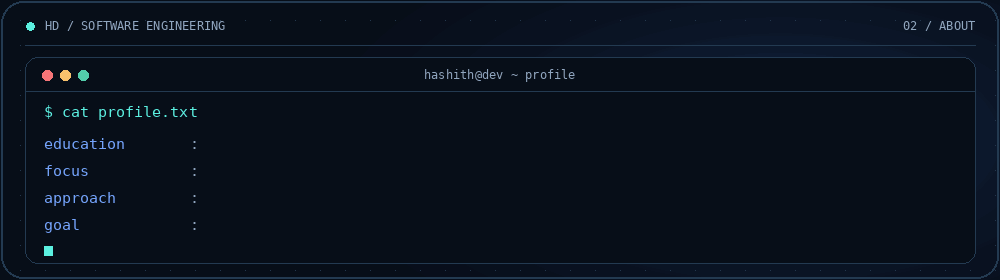
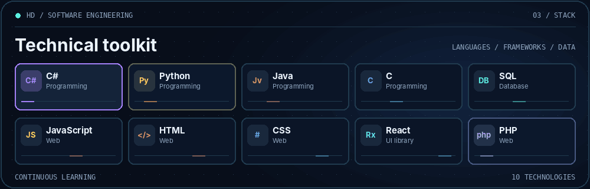

  
  
<a href="https://github.com/Hashith-Dissanayaka?tab=repositories">Explore my work</a> &nbsp; • &nbsp; <a href="mailto:hashithdissanayaka@gmail.com">Email me</a> &nbsp; • &nbsp; <a href="https://github.com/Hashith-Dissanayaka">GitHub profile</a>

## About me

I'm **Hashith Dissanayaka**, an IT student at the **National Institute of Business Management (NIBM), Sri Lanka**. I'm interested in software engineering and full-stack development, with a focus on creating practical applications that solve real-world problems.

I enjoy working across user interfaces, application logic and databases. Through coursework and personal projects, I'm developing my understanding of object-oriented design, maintainable code and database-driven applications.

## Technical toolkit

   &nbsp;
   &nbsp;
   &nbsp;
   &nbsp;
   &nbsp;
   &nbsp;
   &nbsp;
   &nbsp;
  

| Area | Technologies |
| :--- | :--- |
| Programming | C# · Python · Java · C |
| Web development | HTML · CSS · JavaScript · React · PHP |
| Databases | SQL · MySQL · SQL Server |
| Desktop development | C# · .NET · WPF |
| Tools | Git · GitHub · Visual Studio · VS Code · IntelliJ IDEA |

## Project portfolio

I explore software development through academic work and personal projects, with interests in desktop applications, web development and mobile applications.

**Current coursework focus:** Object-oriented programming, database-connected desktop applications, role-based access and real-world software requirements.

[Explore my public repositories →](https://github.com/Hashith-Dissanayaka?tab=repositories)

<!-- Add your best verified repositories here. For each, include its name, problem solved, stack, personal contribution and repository link. -->

## GitHub activity

Activity is refreshed daily through GitHub Actions after the first successful workflow run.

## Let's connect

I'm interested in collaborating, learning from other developers and growing my practical software engineering experience.

**Email:** [hashithdissanayaka@gmail.com](mailto:hashithdissanayaka@gmail.com) · **GitHub:** [@Hashith-Dissanayaka](https://github.com/Hashith-Dissanayaka)

