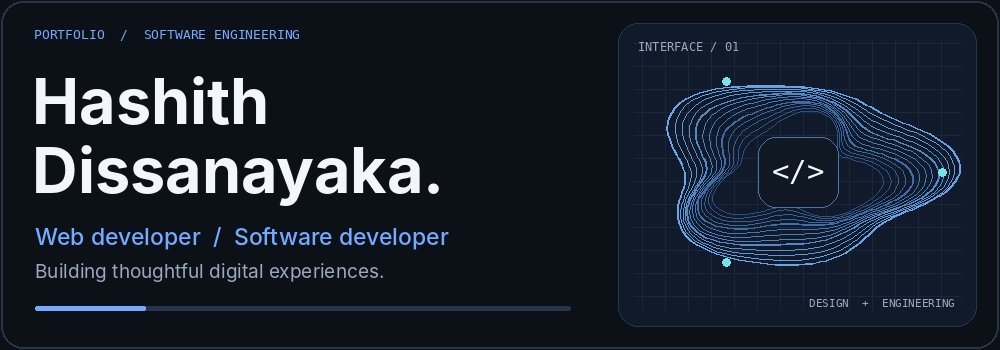
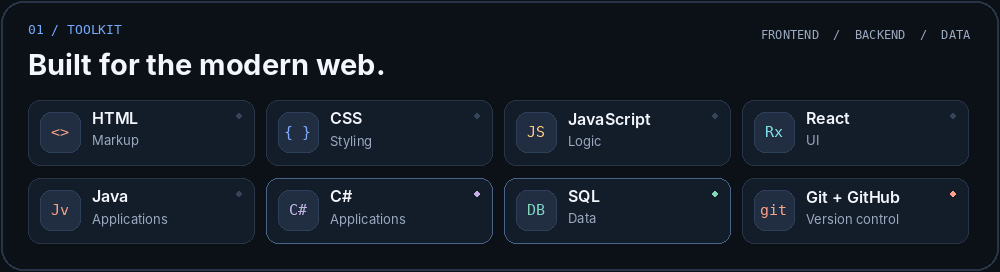
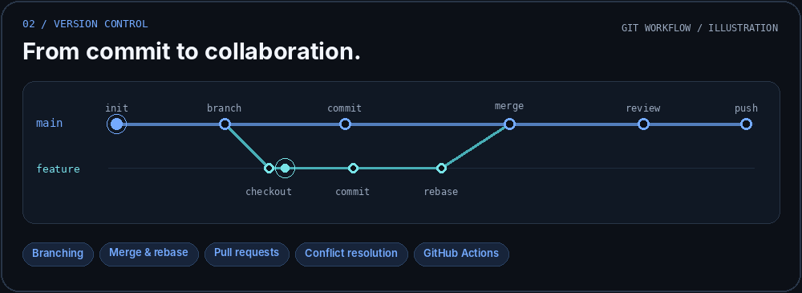
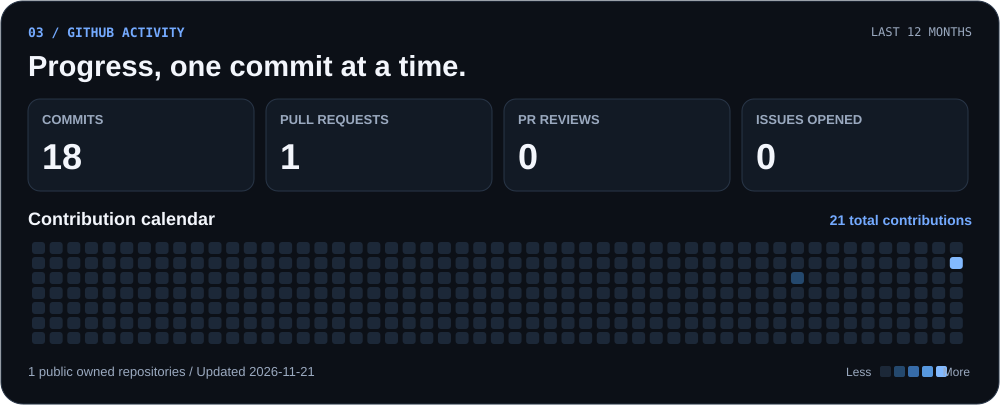

  

I build modern web experiences and practical software solutions, combining clean interfaces, reliable code and thoughtful data design. I value maintainable projects, effective version control and continuous improvement.

  <a href="https://github.com/Hashith-Dissanayaka?tab=repositories"><b>Explore projects ↗</b></a> &nbsp;·&nbsp;
  <a href="https://github.com/Hashith-Dissanayaka"><b>GitHub profile ↗</b></a>

  
  
  

Git activity is fetched from GitHub and reflects contributions visible to the workflow token over the last year. Private activity may be excluded. The animated branch diagram illustrates a workflow, not actual repository history or measured skill percentages.

  DESIGN WITH INTENT · SHIP WITH CONFIDENCE · KEEP LEARNING

