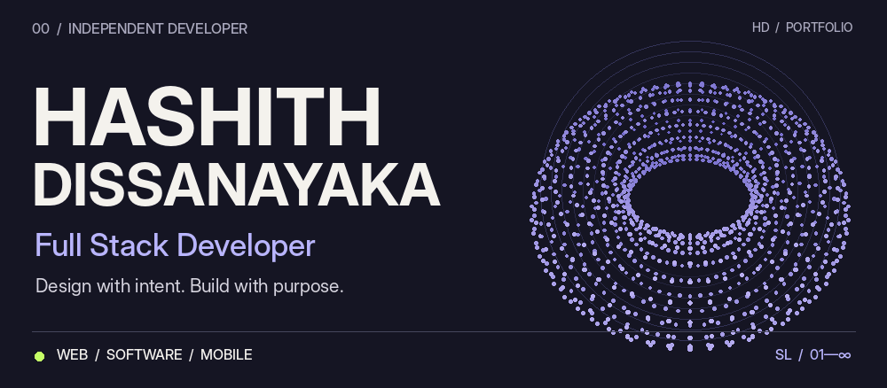
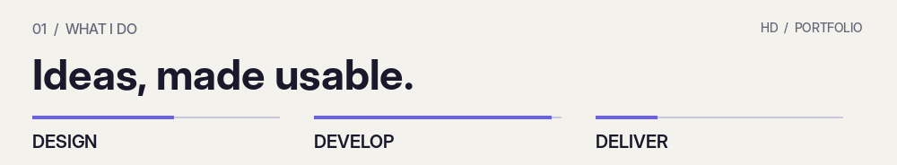
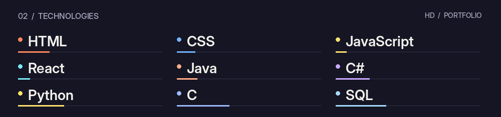
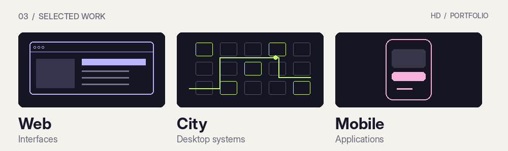
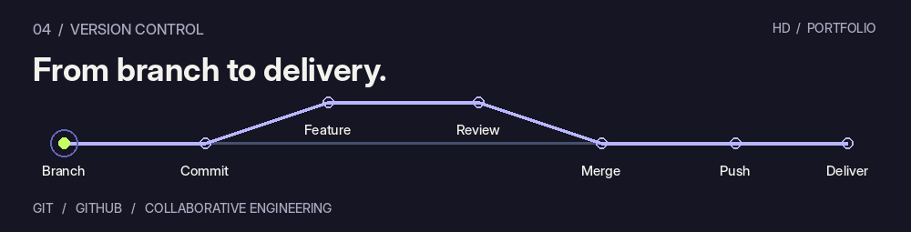
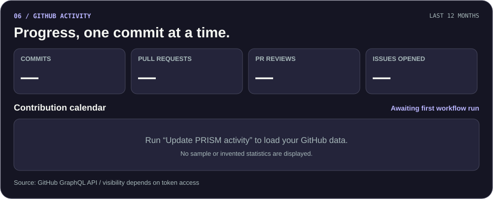
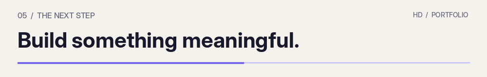

<a href="https://github.com/Hashith-Dissanayaka?tab=repositories"><b>Explore repositories ↗</b></a> &nbsp; / &nbsp; <a href="mailto:hashithdissanayaka@gmail.com"><b>Contact ↗</b></a>

## Hi, I'm Hashith.

I'm a **Full Stack Developer** who enjoys turning ideas into useful digital products. I build websites, desktop applications and mobile apps, bringing together thoughtful interfaces, reliable logic, structured data and clean version control. I enjoy exploring the full development lifecycle, from the first concept to delivery.

I believe great software should be as practical as it is beautiful. My ambition is to build my own software development company and create meaningful digital solutions.

**What I do:** Web development · Software development · Mobile app development · UI/UX design · Database management

**What I explore:** Cyber security · DevOps · Open source · Game development

## Technology toolkit

**Frontend:** HTML · CSS · JavaScript · React · Bootstrap  
**Software & backend:** Java · C# · Python · C · Node.js · .NET  
**Data:** SQL · MySQL · SQL Server  
**Tools:** Git · GitHub · VS Code · Visual Studio · IntelliJ IDEA · Figma · Linux · Unity

## Selected work

- **Websites** — Modern web interfaces and practical digital experiences.
- **City Management System** — A desktop application project focused on city management.
- **Mobile applications** — Exploring useful and intuitive mobile experiences.

[Browse my public repositories ↗](https://github.com/Hashith-Dissanayaka?tab=repositories)

## Git & engineering workflow

Git is an important part of my development workflow. I value version control, clear commit history, branching, merging and collaborative development with GitHub.

## GitHub activity

[View my contribution history ↗](https://github.com/Hashith-Dissanayaka#year-list-container)

## What's next

My long-term goal is to establish my own software development company, where I can turn ambitious ideas into reliable software and build products that make a difference.

**Let's connect:** [Email me](mailto:hashithdissanayaka@gmail.com) · [GitHub](https://github.com/Hashith-Dissanayaka)

<!-- Uncomment the next line after GitHub Pages is enabled (Settings > Pages > main > /docs). -->
<!-- [Explore my interactive portfolio ↗](https://hashith-dissanayaka.github.io/Hashith-Dissanayaka/) -->
