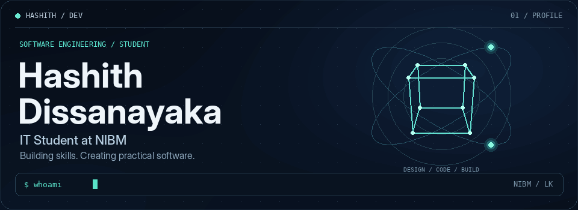
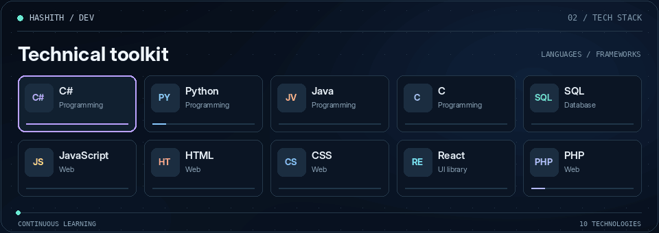
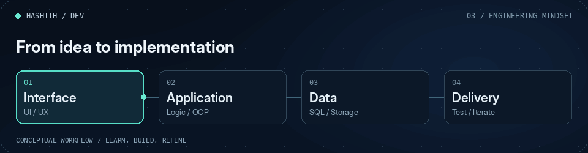

<!-- Custom motion-design profile README. All animations are local GIF assets. -->

  

  

    <a href="https://github.com/Hashith-Dissanayaka?tab=repositories">Explore repositories</a> &nbsp;·&nbsp;
    <a href="mailto:hashithdissanayaka@gmail.com">Email me</a> &nbsp;·&nbsp;
    <a href="https://github.com/Hashith-Dissanayaka">GitHub profile</a>
  

## About me

I'm **Hashith Dissanayaka**, an IT student at the **National Institute of Business Management (NIBM), Sri Lanka**, with an interest in software engineering and full-stack development.

I enjoy turning ideas into practical software, from user interfaces to application logic and databases. I'm developing my skills through coursework, personal projects, and hands-on experimentation, with a focus on readable code, maintainability, and continuous learning.

- **Education:** IT student at NIBM
- **Interests:** Software engineering, web development, desktop applications, and database systems
- **Career goal:** Grow into a software engineer who builds reliable, useful applications

## Technical toolkit

  

| Area | Technologies |
| :--- | :--- |
| Programming | C# · Python · Java · C |
| Web development | HTML · CSS · JavaScript · React · PHP |
| Databases | SQL · MySQL · SQL Server |
| Desktop development | C# · .NET · WPF |
| Development tools | Git · GitHub · Visual Studio · VS Code · IntelliJ IDEA |

## Project portfolio

My work and learning interests include desktop applications, web development, and mobile applications.

<!-- Add verified public project links, screenshots and your specific contribution here when ready. -->

**Coursework focus:** Exploring object-oriented design, database-connected desktop applications, role-based access, and real-world software requirements.

[View my public repositories →](https://github.com/Hashith-Dissanayaka?tab=repositories)

## Engineering mindset

  

I aim to understand the problem before writing code, structure solutions with clear responsibilities, use version control, and test and improve the result. I'm continuing to strengthen these practices as I learn.

## Connect

I'm interested in learning from other developers, collaborating on meaningful projects, and growing my practical software engineering experience.

**Email:** [hashithdissanayaka@gmail.com](mailto:hashithdissanayaka@gmail.com)  
**GitHub:** [@Hashith-Dissanayaka](https://github.com/Hashith-Dissanayaka)

---

  Learn with curiosity. Build with purpose. Improve with consistency.

